<picture><source media="(max-width: 600px)" srcset="./assets/portfolio-mobile.svg"></picture>

**Explore the projects:** [ClipDeck](https://github.com/Mersad-Moghaddam/clipdeck) · [Whisper Social](https://github.com/Mersad-Moghaddam/WhisperSocial-Backend) · [AetherDB](https://github.com/Mersad-Moghaddam/AetherDB) · [Argus](https://github.com/Mersad-Moghaddam/Argus) · [SysKit](https://github.com/Mersad-Moghaddam/syskit)

**Get in touch:** [nickmersad81@gmail.com](mailto:nickmersad81@gmail.com) · [GitHub](https://github.com/Mersad-Moghaddam) · [LinkedIn](https://www.linkedin.com/in/mersad-moghaddam) · [X](https://x.com/MersadMoghadam)
