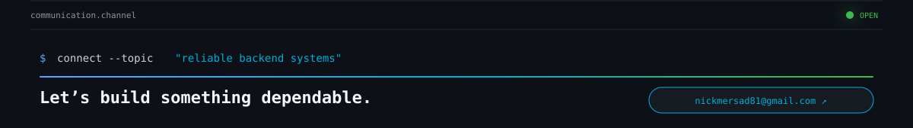

<picture><source media="(max-width: 600px)" srcset="./assets/readme-hero-mobile.svg"></picture> 
<a href="https://github.com/Mersad-Moghaddam/clipdeck"><picture><source media="(max-width: 600px)" srcset="./assets/clipdeck-banner-mobile.svg"></picture></a> 
 
 
<picture><source media="(max-width: 600px)" srcset="./assets/engineering-approach-mobile.svg"></picture> 
<a href="mailto:nickmersad81@gmail.com"><picture><source media="(max-width: 600px)" srcset="./assets/contact-console-mobile.svg"></picture></a>

[GitHub](https://github.com/Mersad-Moghaddam) · [LinkedIn](https://www.linkedin.com/in/mersad-moghaddam) · [X](https://x.com/MersadMoghadam)
